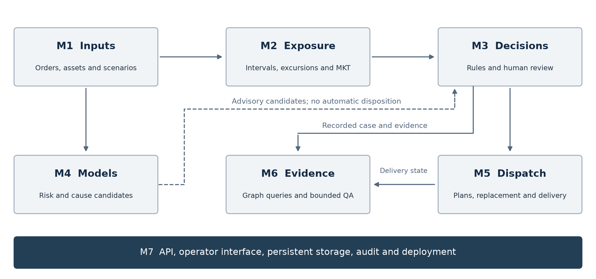
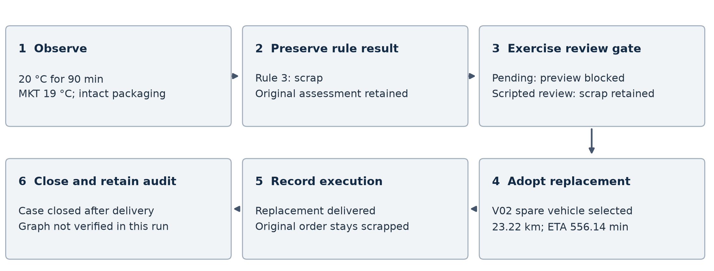
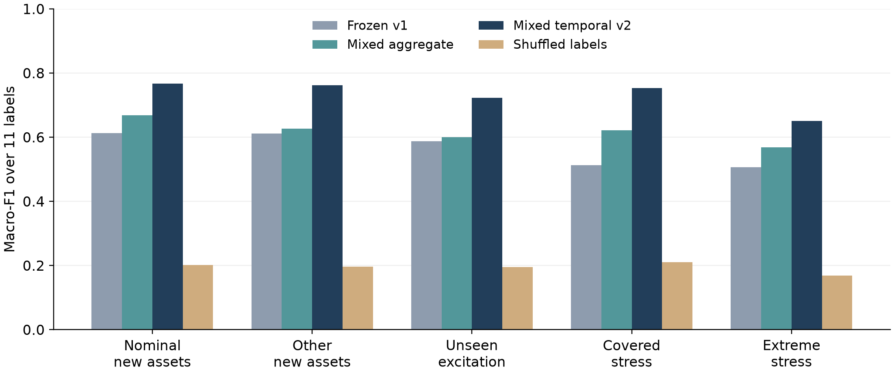
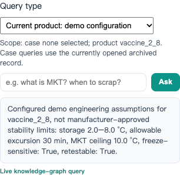

# PharmaColdOps Project Report

## Executive summary

PharmaColdOps is an explainable decision-support prototype for pharmaceutical cold-chain temperature excursions. We connect simulated temperature observations, rule-based disposition recommendations, human review, replacement delivery planning, and case-specific evidence queries in one runnable system. The prototype covers the IRS technique groups of decision automation, knowledge discovery and data mining, resource optimisation, and cognitive systems.

The principal result is an implemented, auditable workflow rather than a validated medicine-quality predictor. M3 agreed with historical adjudicated labels in 54 of 57 synthetic scenarios, but missed all three historical quarantine cases. The shipment-risk experiment achieved five-fold PR-AUC 0.7087 and F1 0.6635; monthly candidate-cause classification remained weak. A subsequent event-level simulation study improved held-out macro-F1, while retaining substantial multi-fault and extreme-condition failures. Static routing experiments produced complete feasible solutions in 49 comparisons.

<!-- M6_ABSTRACT_STATUS_START -->

M6 review covers 53 frozen questions in completed A and current B worksheets. Both identify weak evidence support and failures in scope handling. Historical process gaps and unresolved intent disagreements limit the results to descriptive comparison rather than independent inter-rater validation.

<!-- M6_ABSTRACT_STATUS_END -->

Operational orders and event observations are simulated. Engineering temperature limits are not manufacturer stability limits, model candidates cannot authorise disposition, and human review governs the effective result used by downstream delivery. The deployment is a local demonstration with persistent storage and recovery checks, not a public or clinically validated service.

## 1 Business problem, market context and related work

### 1.1 The operational problem

An excursion creates two connected work requirements. Quality staff must reconstruct the exposure and justify a disposition, while dispatchers must maintain supply if replacement is required. A temperature alert alone does not connect those records. Our project investigates whether explicit rule paths, stable case identifiers and delivery constraints can make this process easier to inspect and demonstrate.

The intended users are quality reviewers, dispatchers, warehouse managers and auditors. The prototype lets them inspect the original observations, distinguish an automatic recommendation from a human decision, compare logistics alternatives and retrieve the evidence associated with the recorded case. Expected benefits include reduced duplicate data entry and clearer handover. We did not conduct an operational controlled trial or measure realised cost savings, medicine wastage reduction or staff productivity.

### 1.2 Market and regulatory context

Temperature-controlled pharmaceutical distribution is governed by good-distribution requirements: storage and transport conditions must be specified, monitored and documented, and deviations must be investigated before a batch is released or rejected [2]. Monitoring itself is a mature market. Data loggers, probes and cloud dashboards are widely deployed, and commercial platforms already combine shipment visibility with stability and quality workflows [1]. The bottleneck we address is therefore not sensing but the handover between an observation, a defensible disposition and the logistics response that follows it.

The workflow is designed around three requirements: decisions remain inspectable after the event, original recommendations survive subsequent human overrides, and replacement plans retain the same case identity. These requirements define the scope of the prototype. The market research in the submitted proposal provides context, while the evaluation in this report focuses on implemented behaviour rather than comparison with commercial products [1].

### 1.3 Related work

Cold-chain excursion evidence. Matthias et al. reviewed freezing events in vaccine cold chains and found them widespread and often undetected by routine practice [14]. Kartoglu and Milstien surveyed the tools available for protecting vaccine quality across the chain and argued that the weakest link is frequently the decision and documentation process rather than the sensor [15]. Both findings support an evidence-first disposition workflow, but neither provides an auditable software path from an excursion observation to a logged, reviewable decision.

Explainability and decision support. SHAP assigns additive feature attributions with a consistent theoretical basis [16]. We use it offline to inspect model behaviour and explicitly do not treat attributions as causes; the operational decision remains rule-based and human-reviewed. This reflects a broader lesson from decision-support research: explanation is a property of the whole workflow, not of a single model output.

Routing. Solomon's VRPTW instances remain the standard comparison set for constrained vehicle routing [6], and OR-Tools provides a time-bounded guided-local-search solver over the same formulation. Our contribution is not a new routing algorithm; it is the integration of routing constraints with case-level replacement demand and recorded execution state.

Knowledge graphs. Property-graph case chains follow the general knowledge-graph model of typed entities and relations [17]. We use fixed template queries rather than an LLM so that every answer has a traceable query, an explicit scope and a distinguishable failure state.

### 1.4 Positioning and contribution

The project contributes an inspectable integration of four IRS technique groups — decision automation, knowledge discovery and data mining, resource optimisation, and cognitive systems — around one case identity. Its distinguishing property is not predictive accuracy but the ability to show, after the fact, which evidence produced which recommendation and which human decision became effective. The prototype is a teaching artefact on simulated data; it is not a validated medicine-quality predictor and does not claim measured operational savings.

## 2 Domain foundations and method selection

WHO TRS 961 Annex 9, EU GDP, ICH guidance and public SOP references provide principles for storage, transport, investigation and stability evidence. We distinguish those principles from our numerical engineering assumptions. A citation to ICH or WHO does not validate a configured excursion duration or mean kinetic temperature ceiling for a specific product [2].

We use deterministic priority rules where an operator must inspect the decision path. The rule engine has release, retest and scrap outputs under its current policy; quarantine remains a historical evaluation label and an available human outcome. Reshipment is a separate logistics action, not a fifth mutually exclusive disposition. Boundary, missing-evidence and low-temperature cases can require human review without rewriting the automatic snapshot [3].

For routing, Solomon VRPTW instances provide standard capacity and time-window problems. Greedy construction supplies an interpretable baseline; OR-Tools RoutingModel with Guided Local Search supplies time-bounded search; a genetic algorithm provides an additional experimental comparison. This is Routing Solver, not CP-SAT, and time-limited results do not prove optimality [6].

For tabular ML, logistic regression and histogram gradient boosting provide reproducible baselines. Offline SHAP and calibration experiments examine behaviour without treating associations as causes. For question answering, fixed intent routing and template Cypher queries allow explicit evidence and failure states. M6 is not an LLM or unrestricted semantic question-answering service [4, 7].

### 2.1 Exposure calculation and rule priority

For each known interval i, M2 uses its duration d_i and absolute temperature T_i in kelvin. Its duration weight is w_i = d_i / sum(d_i). The calculation is MKT_K = -(E_a/R) / ln(sum(w_i exp(-E_a/(R T_i)))); MKT_C = MKT_K - 273.15. The implementation uses log-sum-exp for numerical stability. R is 8.314462618 J/(mol K); the demonstration default E_a is 83.144 kJ/mol, converted to J/mol. Unknown intervals remain unknown and coverage is reported separately; MKT does not establish safety against freezing or replace product-specific stability evidence [10].

The automatic policy evaluates the following ordered conditions and stops at the first match. Let D be the configured allowable duration and K the configured MKT ceiling. These are project assumptions, not regulatory release limits [2, 3].

| Priority | Condition | Automatic output |
|---|---|---|
| 1 | Freeze-sensitive product at or below 0 C | scrap |
| 2 | Compromised packaging above the configured storage maximum | scrap |
| 3 | Duration >= 2D, or MKT >= K + 3 C | scrap |
| 4 | Duration > D, or MKT > K | scrap |
| 5 | Retestable product and (duration >= 0.8D or MKT >= K - 0.5 C) | retest |
| 6 | No preceding condition matches | release |

Human-review guards are applied separately for missing observations, unsupported cold exposure, boundary conditions or an explicit review request. A retained rule recommendation is not an authorisation to release stock. The original snapshot and the effective human disposition remain separate [3].

### 2.2 Routing objective and constraints

The static benchmark ranks only complete solutions with zero recorded hard violations, then minimises vehicle count, then total distance. Its constraints include serving each target once, vehicle capacity, delivery time windows, travel and service time, and return to the benchmark depot. The operational dispatcher additionally groups compatible source/temperature demands, respects remaining vehicle state and mileage, and restricts final parking to selected warehouses. Those operational constraints are not all present in the static Solomon experiment [6, 12, 13].

| Method | Implementation and fixed settings | Reason for inclusion |
|---|---|---|
| Greedy | Feasible route construction; no timed search budget | Interpretable baseline |
| OR-Tools | RoutingModel; parallel cheapest insertion, then Guided Local Search; 10/30/60 s budgets | Established constrained search within a fixed time budget |
| Genetic algorithm | Permutation encoding with split; population 60, seed 42; 10/30/60 s | Evolutionary comparison |

The GA starts with a greedy seed and is therefore not independent of the greedy baseline. Its search cost is 1,000,000 times unserved targets plus 1,000 times vehicles plus distance; these fixed penalties are not proven to impose lexicographic dominance for every instance. The final evaluator independently of that cost applies the complete-feasibility and vehicle-first ranking. OR-Tools is the Routing Solver, not CP-SAT; reaching the time limit does not prove optimality [6].

### 2.3 Learning tasks and model selection

Shipment risk is binary classification from 13 shipment summaries. Monthly candidate cause is ten-class classification from 15 facility/month descriptors. The formal executable candidates are logistic regression and histogram gradient boosting (HGB); optional LightGBM and XGBoost were unavailable in the recorded environment and are not reported as trained models. Each outer training pool is split approximately 60/20/20 into fitting, calibration and selection; the outer test remains untouched until final scoring. All five risk folds selected HGB with sigmoid calibration. Selection uses PR-AUC for the risk classifier, macro-F1 for the cause classifier, Brier score or log loss for calibration, and selection-set F1 for the risk decision threshold [4].

Event-v2 is a different, multilabel task: an event can contain several of 11 injected-mechanism labels. It fits 11 binary HGB classifiers with 100 iterations, 15 leaves, learning rate 0.1, L2 regularisation 1, no early stopping and seed 42. Its 111 features comprise 33 aggregate observations, 60 statistics across four equal-duration observed segments, and 18 temporal/joint statistics. The split uses only the observed prefix, not future fault times or event completion. Candidate screening is chosen on validation data, requiring at least 30 supported events, complete-set precision of at least 90%, and a normal-event supported false-positive rate no greater than 5%; coverage is then maximised. These selection constraints do not guarantee the same precision on new data [5].

## 3 System architecture



The seven modules share case, order and product identifiers while preserving different responsibilities.

| Module | Implemented responsibility | Principal output |
|---|---|---|
| M1 | Dataset validation and reproducible simulated business inputs | Validated features and seeded order batches |
| M2 | Explicit temperature intervals, hot/cold windows and duration-weighted MKT | Exposure summary with coverage and source observations |
| M3 | Priority rules, evidence mappings and review requirements | Original recommendation and rule path |
| M4 | Risk and candidate-cause experiments and advisory inference | Versioned scores and candidate snapshots |
| M5 | Constrained delivery planning and execution | Plans, operation state and explicit infeasibility reasons |
| M6 | Neo4j case chains and structured evidence queries | Case-specific answers and provenance |
| M7 | FastAPI, Vue, SQLite persistence and Docker integration | Bilingual online interface and offline rule sandbox |

The main path is observation to assessment, registration, human review when required, replacement demand, route selection, execution and case closure. The advisory model path does not override M3. An accepted human outcome is stored separately and becomes the effective disposition for subsequent workflow checks. Historical rule and model snapshots remain unchanged [3, 8].

The API commits registration and its graph-outbox entry in one SQLite transaction. A background worker leases pending entries, retries failures and replays complete case chains idempotently into Neo4j. An outbox entry marked synced is not treated as proof that every graph relationship still exists: the audit endpoint can compare actual graph coverage to authoritative case records [8].

The Vue client supports same-origin API mode and an explicit offline rule sandbox. Offline mode does not register cases, write the graph or execute deliveries. The map displays cached road geometry and simulated progress rather than GPS or live traffic. The current operational deployment uses one API worker and loopback binding; distributed logistics transactions and authenticated multi-user operation are outside the demonstrated architecture [9].

## 4 Implementation and workflow

### 4.1 Temperature assessment and human review

M2 consumes explicit simulated temperature intervals and records known coverage. It calculates duration-weighted MKT, contiguous excursion windows and the selected event range. Missing intervals are not replaced with fabricated readings. A wholly unassessed sequence does not acquire an invented scalar temperature or MKT. The API recalculates derived values rather than trusting a mismatching client summary [10].

M3 records product, stage, packaging, exposure, rule number, reason and mapped evidence. Registration is durable and idempotent by draft identity. A boundary result can be registered for review without being treated as final approval. Pending review blocks linked downstream actions; an explicit human decision records reviewer identity, reason and time. Version checks reject stale mutations, and executed outcomes cannot be retroactively changed [3].

Case audit export provides printable HTML and a full JSON snapshot. It includes original assessment, human review history, recorded model identity, associated delivery state and actual graph coverage. It does not recompute an old case with a newer model. A content hash detects a changed snapshot but is not a cryptographic signature or compliance certificate [11].

### 4.2 Delivery planning and execution

The order generator records effective configuration, date, seed and source hashes. Operators can demonstrate routine demand, tight delivery windows, multiple sources or temperature zones, and insufficient resources. Real hospital orders, exact cargo quantities and warehouse stock balances are not required for this teaching scenario [12].

Independent urgent orders use the same operation and candidate constraints as ordinary replacement demand. Plan previews do not reserve a vehicle; adoption is an explicit action with version and retry protection. Execution uses a simulated clock. The final allowed parking facilities are a user-selected subset of five warehouses; hospitals cannot be day-end terminals. Parking must complete before a new day inherits vehicle positions [12].

The isolated worked example in Section 4.4 makes this state flow concrete. It follows one operation and its linked case through assessment, replacement and closure.

Delay inspection identifies late remaining work and can preview reordering under the same constraints. Mechanical failures freeze the affected vehicle and retain failed original orders while separately tracking feasible replacement work. The demonstration does not invent vehicle-to-vehicle transfer, towing or repair capability. PDPTW in-transit rescue is explicitly unsupported rather than silently approximated [13].

### 4.3 Advisory models and graph queries

Risk and monthly candidate-cause models require explicit input contexts and save their first assessment with model identity. The independent event-v2 interface uses 111 allowed observation-derived features and a trusted read-only model bundle. Candidates and abstentions both require review; automatic actions remain disabled. Invalid or unavailable bundles produce an explicit unavailable state rather than a substituted model [5].

M6 supports disposition reasons, audit chains, product requirements, cause context and disposition statistics. Missing cases, insufficient evidence and graph unavailability are distinct states. The current frontend labels conceptual help separately, offers explicit structured query selection and refuses unsupported questions. Failed graph queries do not silently become conceptual answers [7].

### 4.4 A reproducible excursion and replacement case

A fresh isolated API run on 23 October 2026 used simulated operating date 1 October 2026, seed 41, four ordinary vaccine orders, one urgent insertion and three available vehicles. The case was R20261023-001308-994369-2b56602c, linked to order SIM-20261001-e813eb7885-O001 in operation PLAN-DEMO-DAY1. All quantities and observations are simulated. The event was entered as a scalar summary, so this example does not claim a new sensor-series/M2 evaluation [19].

The vaccine_2_8 event occurred at W-WESTGATE for delivery to H-NTFGH: 20 C for 90 min, MKT 19 C and intact packaging. The configured duration allowance is 30 min and MKT ceiling 10 C. Rule 3 fires first because 90 >= 2 times 30 and 19 >= 10 + 3, yielding scrap. An explicit review request keeps the effective decision pending and replacement preview returns HTTP 422. An automated test transaction then exercises the review API and retains scrap. This verifies the software transition under a prescribed decision; it does not evaluate a quality reviewer's judgement [19].



After that transaction, four feasible replacement candidates were returned. V01/V02/V03 abbreviate the corresponding vehicle suffixes. ETA is minutes after midnight on the simulated day; distance is the candidate schedule distance returned by the API, not extra distance saved against a common baseline [19].

| Candidate | Vehicle | Schedule km | ETA min | Other orders affected |
|---|---|---:|---:|---:|
| Spare vehicle, selected | V02 | 23.22 | 556.14 | 0 |
| Spare vehicle | V03 | 23.22 | 556.14 | 0 |
| Insert into in-transit route | V01 | 37.13 | 556.14 | 4 |
| Return to depot | V01 | 37.13 | 571.14 | 4 |

All four had zero predicted lateness. The two spare vehicles tie on the displayed metrics; choosing V02 demonstrates an accepted feasible option, not a claim that it is uniquely optimal. The accepted replacement RO-R20261023-001308-994369-2b56602c was subsequently recorded as delivered while the original order remained scrapped. The case progressed to handled and then closed; retrying registration retained the same case identity, and closing before replacement delivery was rejected [19].

The day-one snapshot contains six orders: five delivered (three unaffected ordinary orders, one urgent order and one replacement) and one scrapped original. No vehicle remained on its return trip. Parking was completed before day two inherited the actual vehicle locations; temporary urgent/replacement jobs were not copied into the next fixed daily batch. The example passed 27 assertions. The stored reference IDs remain visible in the case record, but graph writing was explicitly disabled and graph coverage was not verified. These API/state checks are not browser acceptance, M6 answer-quality scores or a real operational-benefit trial [19].

## 5 Data and evaluation design

There is no public dataset in this project with independently validated medicine release, quarantine, retest and scrap decisions. We therefore evaluate each component against an appropriate and explicitly limited reference. The M3 scenario bank contains 57 synthetic scenarios with historical human adjudication. ML sources and licences are recorded in the data dictionary: the shipment-risk set is a public Kaggle release under CC0 whose documentation and internal checks indicate synthetic generation, and the monthly cause set is explicitly simulated [2, 4].

The risk task uses 8,000 shipment rows, including 1,574 failures, with 13 summary features. The cause task filters 16,192 excursion-month rows into ten candidate-cause classes with 15 features. The latter has 447 provided facility-ID groups and 48 months, but these are not verified real institutions or event timestamps [4].

The formal ML protocol separates fitting, calibration, selection and final outer testing. Risk uses five stratified outer folds because its source lacks timestamps. Cause experiments include random, provided-facility-ID and month-forward folds, with full and context-only feature sets. Preprocessing and weighting use the fitting partition; test data do not choose thresholds. These are separate tasks from event-v2 simulation and must not share an accuracy headline [4].

Event-v2 has 10,200 simulated events and 9,597 families across training, validation and five held-out roles. Models and screening policy were frozen before final test generation. Asset, family and excitation controls reduce shortcut leakage, but all cohorts still come from the same uncalibrated simulator. They do not establish external physical or clinical validity [5].

## 6 Experimental results

### 6.1 Rule engine

M3 agreed with 54 of 57 historical labels, or 94.7368%. Macro-F1 was 0.717437. Engine-to-gold Cohen's kappa was 0.909667; historical annotator-to-annotator kappa was 0.6434. These are different statistics. All three quarantine-labelled cases were missed because the current frozen engine policy has no automatic quarantine output. We retain those cases and the four-class denominator [3].

| Historical class | Support | Recall | F1 |
|---|---:|---:|---:|
| release | 13 | 1.0000 | 0.9286 |
| retest | 8 | 1.0000 | 0.9412 |
| quarantine | 3 | 0.0000 | 0.0000 |
| scrap | 33 | 1.0000 | 1.0000 |

The three discrepancies are S034, S035 and S052. They represent a difference between the written policy and historical adjudication, not proof that either side is clinically correct. Human review protects the operational workflow but does not improve this frozen automatic-engine score [3].

### 6.2 Shipment risk and monthly candidate causes

| Risk metric | Five-fold result |
|---|---:|
| F1 at selection-chosen thresholds | 0.6635 +/- 0.0179 |
| ROC-AUC | 0.9045 +/- 0.0092 |
| PR-AUC | 0.7087 +/- 0.0296 |
| Brier score before and after calibration | 0.1091 to 0.0933 |

The selected risk model can also be compared with the recorded empirical-prior/majority baseline. The baseline has F1 0, ROC-AUC 0.5, PR-AUC approximately 0.1968 and Brier approximately 0.1580. The model's PR-AUC of 0.7087 therefore exceeds prevalence-based prediction on this dataset. F1, ROC-AUC and PR-AUC values above are fold means with sample standard deviations, not confidence intervals or evidence of real-world clinical performance [4].

For full15 monthly cause classification, macro-F1 was 0.1322 under random folds, 0.1308 under provided-ID folds and 0.1259 under month-forward testing. Corresponding Top-1 results were 0.1713, 0.1500 and 0.1497. Calibration improved probability losses but did not change class rankings. Weak extra feature signal, contextual shortcuts and insufficient event-level information motivated the separate learnability audit and simulator work [4].

The cause-feature ablation uses identical outer partitions for the 15-feature model and the seven context features. The latter retain facility level, region, equipment type and age, vaccine name, and freeze/heat sensitivity; they omit same-month equipment/power/logging fields and calendar fields [4].

| Split | Full15 macro-F1 | Context7 macro-F1 | Full15 Top-1 | Context7 Top-1 |
|---|---:|---:|---:|---:|
| Random five-fold | 0.1322 | 0.1310 | 0.1713 | 0.1496 |
| Provided facility ID | 0.1308 | 0.1358 | 0.1500 | 0.1618 |
| Month-forward | 0.1259 | 0.1314 | 0.1497 | 0.1588 |

Random-fold and facility-fold tests cover all 16,192 rows. Month-forward tests cover 14,520 rows after excluding the first 1,672 warm-up rows, so these are not identical test populations. The full15 random-fold majority baseline achieves Top-1 approximately 0.1607 and macro-F1 approximately 0.0277. Additional dynamic monthly inputs do not consistently beat the context-only model; facility/time Top-1 is below the corresponding majority baselines. The risk out-of-fold predictions also include 360 false negatives and 871 false positives. These failures matter more than a single overall accuracy claim [4].

The M4 experiment used model-identity-matched offline Kernel SHAP with 12 held-out examples, 12 training-background examples and a subset budget of 128 per model, including additive reconstruction checks. The small explanation sets limit population-level interpretation. Online single-feature reference replacement provides a separate sensitivity display; neither procedure establishes the cause of an individual event [4].

### 6.3 Event-level temporal study

The five test cohorts each contain 600 events. Training uses 3,000 nominal and 3,000 stress events; validation uses 600 of each. The selected model and screening policy are frozen before the 3,000 test events are generated [5].

| Held-out role | Frozen v1 | Mixed aggregate | Mixed temporal v2 | Shuffled labels |
|---|---:|---:|---:|---:|
| Nominal new assets | 0.6125 | 0.6689 | 0.7668 | 0.2010 |
| Other new assets | 0.6111 | 0.6263 | 0.7619 | 0.1962 |
| Unseen excitation | 0.5880 | 0.5997 | 0.7228 | 0.1956 |
| Covered stress | 0.5126 | 0.6221 | 0.7528 | 0.2098 |
| More extreme stress | 0.5068 | 0.5686 | 0.6505 | 0.1692 |

All entries are macro-F1 over 11 labels, not the fraction of events with every mechanism correct. Mixed aggregate and mixed temporal use the same 6,000 training events and differ in observed features (33 versus 111). The shuffled-label control retains product/family structure and is a diagnostic control, not an independent statistical null. Frozen-v1 versus v2 also changes training coverage and thresholds, so that comparison alone cannot attribute the gain to temporal features [5].



| Held-out role | Supported / tested | Supported coverage | Complete-set correct / supported |
|---|---:|---:|---:|
| Nominal new assets | 104 / 600 | 17.33% | 96 / 104 |
| Other new assets | 124 / 600 | 20.67% | 116 / 124 |
| Unseen excitation | 83 / 600 | 13.83% | 75 / 83 |
| Covered stress | 15 / 600 | 2.50% | 15 / 15 |
| More extreme stress | 0 / 600 | 0% | Unavailable |

For the fixed selected model, 300 family-bootstrap resamples give conditional 95% macro-F1 intervals of [0.7462, 0.7876], [0.7444, 0.7809], [0.6982, 0.7443], [0.7298, 0.7701] and [0.6301, 0.6703] in table order. They exclude training/selection uncertainty and external-generator uncertainty; they are not clinical confidence intervals [5].

Among supported candidates, complete-set precision was 96/104, 116/124 and 75/83 in the first three roles. Covered stress had only 15 supported events; 15/15 does not establish a population guarantee. Extreme stress supported none, so precision is unavailable rather than 100%. All 3,000 test events still required human review [5].

Raw normal-event false alarms remained 47.73-90.80%. Extreme multi-fault complete-set accuracy fell from 11.96% to 8.70% despite improved recall. Thermal-buffer F1 remained approximately 0.079-0.260. Observationally identical door/staff and power/fuel mechanism combinations show why tuning alone cannot resolve every cause label. The system must expose ambiguity and request additional evidence [5].

### 6.4 Static routing

The formal comparison has 49 solver runs across six Solomon instances and one Singapore instance. All runs served every target without recorded hard violations. On Singapore, greedy used three vehicles and 165.26 km; OR-Tools used three and 137.85 km. This is a 16.59% distance reduction for that frozen static instance, not an operational savings estimate [6].

OR-Tools matched the published two-decimal reference distances on C101 and C201. R101 and R201 had same-fleet distance gaps of approximately 0.1656% and 0.1753%. RC101 used 16 vehicles against the reference 14, so its shorter distance cannot be described as beating that reference. GA did not outperform OR-Tools in this experiment. Each configuration had one run; no multi-seed significance claim is made [6].

The distance comparison below uses the 60-second budget for both search methods. Each cell is vehicles / distance; Solomon distance is in Euclidean instance units and Singapore distance is in road kilometres. Distances across those two scales must not be averaged [6].

| Instance | Greedy | OR-Tools 60 s | GA 60 s |
|---|---:|---:|---:|
| C101 | 10 / 852.95 | 10 / 828.94 | 10 / 852.95 |
| C201 | 3 / 749.36 | 3 / 591.56 | 3 / 749.36 |
| R101 | 20 / 2051.90 | 19 / 1653.53 | 20 / 2029.57 |
| R201 | 5 / 1884.36 | 4 / 1254.57 | 5 / 1848.08 |
| RC101 | 17 / 2085.38 | 16 / 1669.37 | 17 / 2049.29 |
| RC201 | 5 / 2075.83 | 4 / 1443.75 | 5 / 2054.67 |
| Singapore | 3 / 165.26 | 3 / 137.85 | 3 / 137.85 |

The 49 runs comprise one greedy run and six timed runs per instance (two search algorithms times three budgets). Every run recorded zero unserved targets and zero hard violations; served/all and on-time/all were both 100%. The following selected cases illustrate where extra time did and did not help; vehicle count is unchanged across budgets within each listed method [6].

| Instance and method | 10 s distance | 30 s distance | 60 s distance |
|---|---:|---:|---:|
| RC201 OR-Tools, 4 vehicles | 1531.72 | 1443.75 | 1443.75 |
| RC201 GA, 5 vehicles | 2065.72 | 2055.57 | 2054.67 |
| R101 GA, 20 vehicles | 2039.23 | 2039.23 | 2029.57 |
| Singapore OR-Tools, 3 vehicles | 137.85 | 137.85 | 137.85 |

Observed solver runtimes were 10.001-10.113 s, 30.001-30.048 s and 60.001-60.073 s for the three budgets. The machine was not CPU-exclusive, so these are execution records rather than a dedicated-hardware speed benchmark. Singapore summed vehicle work time was 495.93 min for greedy and 484.62 min for OR-Tools/GA; this is not the arrival time of the final vehicle. For RC201, OR-Tools' same-fleet distance gap to the reference was 2.6163%, retaining a visible failure to match the best-known solution [6].

These are static single-origin algorithm comparisons. Urgent insertion, grouped operations, delay recovery, failure handling and overnight parking are implemented workflow features verified separately, not additional measured rows in that benchmark [6, 13].

### 6.5 Knowledge graph and answer review

The frozen M6 preparation performed 12 actual service queries and 41 client conceptual fallbacks on 53 questions. The same 57 case scenarios passed 466 derived contract checks for record agreement, mapped references, thresholds, states and case isolation. Derived checks do not establish independent answer correctness or citation relevance [7].

<!-- M6_HUMAN_RESULTS_START -->

The A and current B review sets each contain 53 intent labels and 53 answer/evidence ratings for the same frozen questions and response hashes. B reported no prior exposure to A, previous B worksheets, frozen responses or routing code before intent review. B's intent file was saved before the second-stage materials were prepared. B confirmed personal judgement and actual consultation of the listed sources. These are self-reported process statements. A's historical sealing times and source-consultation record remain unverified, so this closeout reports a descriptive comparison rather than independent reliability [7, 20].

Intent labels and acceptable-label sets match on 15/53 questions and differ on 38/53. B marked 37/53 questions ambiguous. Disagreements remain unadjudicated, so no adjudicated intent gold standard, independent accuracy, kappa or jointly validated answer-adequacy score is reported. The table retains all 53 questions per reviewer, including not-applicable (NA) ratings. Correctness, relevance and sufficiency use 0, 1 and 2; refusal appropriateness uses 0 or 1. B's source consultation includes external and project references as declared by the reviewer; the compiler did not independently re-audit those sources [7, 20].

| Review dimension | Sheet | Score 0 | Score 1 | Score 2 | NA |
|---|---|---:|---:|---:|---:|
| Answer correctness | A | 4 | 21 | 28 | 0 |
| Answer correctness | B | 10 | 37 | 6 | 0 |
| Evidence relevance | A | 41 | 0 | 8 | 4 |
| Evidence relevance | B | 39 | 6 | 2 | 6 |
| Evidence sufficiency | A | 41 | 4 | 4 | 4 |
| Evidence sufficiency | B | 41 | 4 | 2 | 6 |
| Refusal appropriateness | A | 4 | 2 | Not used | 47 |
| Refusal appropriateness | B | 4 | 2 | Not used | 47 |

A assigns full correctness to 28/53 answers, compared with 6/53 in B; partial correctness accounts for 21/53 and 37/53 respectively. Unsupported claims are marked in 10/53 answers by A and 15/53 by B. These differences concern judgements of the same answers, not a change in system performance. B more often distinguishes a relevant conceptual response from a complete answer to the case-specific request. Both reviews rate evidence sufficiency as zero for 41/53 answers, making inadequate support a consistent weakness [7, 20].

The ratings are retained as submitted rather than reconciled to force agreement. An answer can be plausible while its cited source does not support its product-specific conclusion. Review findings therefore guide failure analysis and interface repair; they do not establish pharmaceutical validity.

<!-- M6_HUMAN_RESULTS_END -->

| Frozen example | Observed failure | Current repair and verification boundary |
|---|---|---|
| Q002/Q004, discard or destruction | Blanket mandatory-scrap wording with no product-specific stability evidence | Concept text now identifies prototype assumptions; regression checks only |
| Q011/Q038, actual vaccine potency | Generic promotional fallback instead of refusing certification | Explicit unsupported response; no independent post-repair score |
| Q028/Q050, weather | Irrelevant graph claim instead of a scope refusal | Refusal path does not query the graph |
| Q009/Q021, who | Ambiguous word treated as a regulatory keyword | Token boundaries and explicit query choices reduce keyword collisions |

These examples illustrate failures in the frozen responses; they are not mutually exclusive error counts. The interface changes address the observed problems, but their effect on answer quality requires evaluation on a new frozen question set. The current software checks do not replace that evaluation [7, 18, 20].

The current interface now separates structured graph queries, concept help, clarification and refusal. It offers five explicit query types, clears stale replies on context changes and exposes recorded reference links. General FAQ text no longer asserts mandatory destruction or that every response has regulatory grounding. These are repairs informed by observed failures and developer regression checks; they do not change or re-score the frozen v1 answers.



## 7 Reliability and reproduction

The latest recorded full-suite regression on 2026-10-17 passed 926 tests with zero skips and six existing warnings; a separate API walkthrough passed 36 checks against its own test graph. Frontend production build and nine frontend check scripts passed. Real browser checks covered refusal, concepts, source links, missing and conflicting scope, late replies after case changes, and injected transport failure without changing case records. Twenty live advisory sample replays retained their prior result fingerprint after the QA-only deployment update. These are software checks, not new model-accuracy observations [9].

Additional isolated API acceptance on 23 October 2026 passed 33 checks; the explicit review-gate case study passed 27 checks. These counts overlap in covered behaviours and must not be added as distinct coverage. Neo4j was not verified in either fresh run. The worked example used Python 3.12.14, FastAPI 0.159.1, httpx 0.28.1, OR-Tools 9.15.6755, NumPy 2.5.4 and scikit-learn 1.9.1 on macOS arm64. This acceptance environment differs from the original locked demonstration baseline; the new runs do not replace the historical full-suite or deployment evidence [19].

Earlier checks passed 909 tests after correcting an incomplete temporary graph seed. A later 925-test run exposed optional reference metadata being filtered from HTTP responses; the response schema and serialization contract were repaired before the successful 926-test run. These earlier results and the historical 888-test baseline remain separate records. Local map-tile and no-active-operation 404 responses, plus a large-JavaScript-chunk warning, remain disclosed presentation limitations [9].

The deployment pins Python, frontend and Docker dependencies, runs the API as a non-root user with read-only root filesystem, and persists authoritative case data independently of Neo4j. Previous acceptance exercised actual API restart, graph outage, outbox recovery and backup restoration into new volumes. These checks demonstrate recovery for the tested configuration, not high availability or a production service-level agreement [8, 9].

For reproduction, clone the repository, create the documented Python 3.12 environment, install the evaluation lock, and use the Linux-container Docker path. Native Windows workflow mutations are unsupported because their file guard requires Unix fcntl; the standalone M6 format checker is portable. Native Linux amd64 and arbitrary offline builds have not been established by the historical arm64 checks [9].

## 8 Findings and discussion

### 8.1 What the results support

The implemented workflow supports a narrow but real claim: an excursion can travel from observation to a recorded, inspectable decision and a synchronised delivery response without losing the original evidence. The rule engine reproduces 54 of 57 historical adjudications; the risk model reaches a five-fold PR-AUC of 0.7087; the event-level study improves held-out macro-F1 across five roles; and static routing produces complete feasible plans in 49 runs. Each result belongs to its own protocol, and none of them is an end-to-end accuracy figure.

### 8.2 Why the rule engine misses quarantine

All three disagreements are quarantine cases (S034, S035 and S052). The frozen policy emits only release, retest and scrap, while quarantine exists as a human outcome and as a historical label. The gap is therefore a specification difference, not a coding defect: the historical annotators used a category the deployed policy does not produce. We keep the four-class denominator and report zero quarantine recall rather than relabelling the cases to improve the headline number.

The same reasoning limits how the agreement rate should be read. Fifty-four of fifty-seven is agreement with one frozen adjudication on a small synthetic scenario bank, not clinical accuracy. Engine-to-gold kappa is 0.909667 on this particular class distribution; we have not established that class imbalance inflates it. Release, retest and scrap each have recall 1.0, but release/retest F1 values of 0.9286/0.9412 show that their predictions are not perfect: the missed quarantine cases enter those predicted classes. Historical annotator-to-annotator kappa of 0.6434 describes a different comparison and must not be presented as a directly comparable system-improvement baseline.

### 8.3 Why monthly cause classification remains weak

The cause dataset has no event timestamp and only monthly aggregates. Its 447 provided facility groups and 48 months add some structure, but not the physical signal that separates mechanisms such as door opening from staff handling. Macro-F1 near 0.13 and Top-1 near 0.17 are consistent with weak extra feature signal rather than a tuning failure; the learnability audit, including shuffled-label controls and capacity probes, supports that reading. The practical consequence is that candidate causes remain advisory labels for a human reviewer, not diagnoses.

### 8.4 What the event-level study adds

The simulated event study supplies the temporal and mechanistic detail the monthly data lack. Held-out macro-F1 rises to roughly 0.65–0.77 and within-supported precision is high, but supported coverage stays between 0% and 20.7%, and the extreme-stress cohort supports no candidates at all. Normal-event false alarms remain 47.7–90.8%. Improvement on one simulator is not external validity: all 3,000 test events still required human review, and the extremes show that multi-fault ambiguity survives both better models and more data.

### 8.5 Deployment implications and limits

The system is a single-worker, loopback-bound demonstration with persistent storage and recovery checks. It has no authentication, no multi-user transaction control and no production service-level agreement. The audit hash detects change; it is not a signature or a compliance certificate. The map shows cached geometry, not live GPS or traffic. These are deliberate boundaries for a teaching prototype, and they are stated in the interface and the user manual rather than left implicit.

### 8.6 Future work

The next evaluation should test the revised M6 interface on a newly frozen question set, with judgements collected independently before comparison and disagreement resolution. The current A and B reviews describe the earlier frozen responses. Product-specific stability evidence is also required to replace engineering assumptions with defensible release limits. Authenticated multi-user operation, integration with real orders and production monitoring remain directions for deployment beyond the teaching prototype.

### 8.7 Team contributions and cross-review

Role identifiers map to A: Xu Wenzhe, B: Zhu Jianyu, C: Wang Lepeng and D: Shen Ziyi, consistent with the submitted proposal. Module ownership follows the proposal and is recorded here for traceability. It is not a mark allocation, and the confidential peer-review forms remain the official contribution record.

| Area | Primary responsibility | Cross-review responsibility |
|---|---|---|
| M1 simulated data and seeds | B | A: provenance, licence and data-dictionary audit |
| M2 exposure and MKT | B | A: formula, interval and missing-data contract review |
| M3 rules and rule evaluation | A | B: threshold and label review |
| M4 risk and cause experiments | B | A: split, calibration and leakage review |
| M5 routing and dispatch | C | D: API and UI contract review |
| M6 graph and QA | D | A: evidence-state and refusal review |
| M7 API, frontend and deployment | D | C: dispatch contract review |
| Report, videos and submission pack | A report, D videos, C packaging, B data statements | Whole-team read-through |

The table summarises module ownership and the planned cross-review structure. Individual contribution assessment is documented separately through the course peer-review process. The module role codes A-D are distinct from the A/B labels used for the M6 review worksheets.

### 8.8 Changes from the proposal and next evaluation

The initial plan combined four dispositions, tabular risk/cause prediction, route optimisation and evidence queries. Implementation clarified that automatic policy emits three dispositions, while quarantine is a human outcome and a historical gold label. The weak monthly cause benchmark led to a separate event-level simulator and temporal-feature study. The QA design remained bounded graph queries; observed fallback and provenance failures led to explicit scope, clarification and refusal states. These changes preserve the integration goal while narrowing what the metrics can justify [1, 3-7].

The expected business value is fewer disconnected handovers: one case identity links the original evidence, effective decision, replacement order and audit. No time-saving or waste-reduction percentage has been measured. A next operational study should compare the same scripted tasks against a documented manual workflow, measuring completion time, missing required records, incorrect case/order links and successful audit retrieval. Task success criteria and failure handling should be fixed before recruiting participants; technical acceptance counts are not user-productivity measurements.

### 8.9 Conclusion

PharmaColdOps integrates exposure assessment, recorded disposition, replacement delivery and evidence retrieval. Experiments support traceable rule execution, feasible constrained routing and persistent case-state management, while exposing weak monthly cause prediction and limited answer evidence. The resulting prototype provides a reproducible basis for further evaluation with independently reviewed questions and real operational tasks.

## References and project evidence

1. Submitted proposal, PharmaColdOps-Proposal-Group 41.pdf, 2026-09-13. Reproduced as Appendix C in the PDF report.
2. [Threshold evidence audit](阈值证据表_v1.md) and [data dictionary](../data/ml/DATA_DICTIONARY.md). Public anchors: [WHO TRS 961 Annex 9](https://www.who.int/publications/m/item/trs961-annex9-modelguidanceforstoragetransport) and [EU GDP](https://eur-lex.europa.eu/legal-content/EN/TXT/?uri=CELEX:52013XC1123%2801%29). The project audit records applicability and assumptions.
3. [M3 formal evaluation](M3正式评估.md) and [human effective dispositions](人工审核与有效处置.md). Frozen formal evaluation, 2026-10-03.
4. [M4 formal experiments](M4正式实验.md) and [cause-data learnability audit](原因数据可学性审计.md). Formal folds, calibration, ablations and model-matched explanations.
5. [Temporal event-v2 evaluation](事件时序模型v2评估.md) and [shadow API and UI](v2只读shadow接口与演示入口.md). Independent event study and advisory contract.
6. [M5 formal evaluation](M5正式评估.md). Solomon, M. M. (1987), Algorithms for the Vehicle Routing and Scheduling Problems with Time Window Constraints, [original paper](https://doi.org/10.1287/opre.35.2.254); frozen comparison documented against [SINTEF reference results](https://www.sintef.no/projectweb/top/vrptw/100-customers/).
7. [M6 evaluation protocol and frozen dataset](M6独立评估.md), [A intent labels](../data/qa/m6-completed-20261016-intent-A.csv) and [A answer ratings](../data/qa/m6-completed-20261016-ratings-A.csv). Original protocol and completed A review inputs.
8. [Graph reliability and recovery](知识图谱可靠性与恢复.md) and [case audit export](案例审计报告导出.md). Authoritative storage, graph coverage and recovery scope.
9. [Reproduction and deployment](复现与本机部署.md), [controlled v2 deployment](v2演示受控更新.md) and [progress log](../PROGRESS.md). Versioned deployment and historical verification records.
10. [M2 temperature and MKT](M2温度序列与MKT.md). Interval semantics, MKT and missingness contracts.
11. [Case audit export](案例审计报告导出.md). Snapshot and hash scope.
12. [Simulated order generator](模拟订单生成器.md) and [urgent orders and parking](独立加急与仓库停车规则.md). Simulated business-input and parking constraints.
13. [End-to-end acceptance](完整演示与端到端验收.md) and [routing design](路径规划总逻辑方案.md). Dynamic workflow scope and acceptance protocol.
14. Matthias, D. M., Robertson, J., Garrison, M. M., Newland, S., & Nelson, C. (2007). Freezing temperatures in the vaccine cold chain: A systematic literature review. Vaccine, 25, 3980–3986. https://doi.org/10.1016/j.vaccine.2007.02.052
15. Kartoglu, U., & Milstien, J. (2014). Tools and approaches to ensure quality of vaccines throughout the cold chain. Expert Review of Vaccines, 13(7), 843–854. https://doi.org/10.1586/14760584.2014.923761
16. Lundberg, S. M., & Lee, S.-I. (2017). A unified approach to interpreting model predictions. Advances in Neural Information Processing Systems 30. https://arxiv.org/abs/1705.07874
17. Hogan, A., Blomqvist, E., Cochez, M., d'Amato, C., de Melo, G., Gutierrez, C., Kirrane, S., Labra Gayo, J. E., Navigli, R., Neumaier, S., Ngonga Ngomo, A.-C., Polleres, A., Rashid, S. M., Rula, A., Schmelzeisen, L., Sequeda, J., Staab, S., & Zimmermann, A. (2021). Knowledge graphs. ACM Computing Surveys, 54, 1–37. https://doi.org/10.1145/3447772

18. [QA repair and new-version acceptance](M6问答修复与新版本验收.md). Frozen v1 failures, current scope/refusal repairs and the distinction between developer regression and independent evaluation.

19. Isolated API case-study records, 23 October 2026. Supplementary files: report-case-study.json, demo-acceptance-report.json and run_report_case_study.py. Automated review transactions; graph coverage outside the test scope.

20. [M6 descriptive review closeout](M6评审收尾.md), 23 October 2026. Current B worksheets and process record are retained in the private handoff package with A inputs, file hashes and 38 unresolved intent disagreements. Earlier B worksheets remain a separate historical version.

## Appendix A Mapping to modular course techniques

| Course area | Applied knowledge and implemented functionality | Evaluation evidence |
|---|---|---|
| MR Machine Reasoning | Knowledge/model representation, reasoning as search and inductive learning: explicit rule paths, constrained route construction and tabular risk/cause models | 57 rule scenarios; search baselines; five-fold ML and held-out simulations |
| RS Reasoning Systems | Optimisation and evolutionary computation: VRPTW formulation, RoutingModel GLS and permutation-based GA; graph-based system integration | Static 49-run routing comparison and separate dynamic execution acceptance |
| CGS Cognitive Systems | Knowledge representation and reasoning with a case/rule/evidence graph and structured user questions; five template queries with explicit failure states | 466 derived contract checks and descriptive A/B reviews of 53 frozen questions; independent reliability not established |

This mapping follows the course agendas in the IRS practice-module briefing, page 3. The separate four technique groups are decision automation (M3), business resource optimisation (M5), knowledge discovery/data mining (M2/M4), and cognitive systems (M6). It does not assert that every optional feature or course topic, such as audio/vision cognition, was implemented.

## Appendix B Installation and user guide

### B1 Fresh demonstration deployment

Requirements are Docker Desktop in Linux-container mode, a free loopback port 8080 and Python 3.12. Create an environment with python3.12 -m venv .venv, then install requirements-eval.lock.txt. On Windows use .venv/Scripts/python.exe in place of .venv/bin/python. First builds require registry, PyPI and npm access.

```text
.venv/bin/python scripts/configure_demo.py
docker compose --env-file deploy/demo.env -f deploy/compose.demo.yml config --quiet
docker compose --env-file deploy/demo.env -f deploy/compose.demo.yml up -d --build --wait --wait-timeout 180
```

Open http://127.0.0.1:8080/?lang=en and check /api/ready. This base deployment defaults to event-v2 disabled. For the existing v2 demonstration use both env files and both compose files from the [controlled deployment guide](v2演示受控更新.md); do not recreate that deployment using only the base configuration. Never add -v when stopping the application's persistent volumes.

### B2 Operator walkthrough

Generate a seeded daily batch and inspect the date, time windows, fleet and allowed final warehouses. Preview the plan and confirm departure. Pause simulated progress while demonstrating an urgent order or registering an excursion linked to the correct original order and occurrence facility. Examine the original rule recommendation and its evidence. Complete human review if required, compare feasible replacement candidates, then adopt one explicitly.

Resume simulated progress and inspect actual recorded delivery status. Complete case notes only after required delivery conditions are met. Ask for the selected case's disposition reason or audit chain; distinguish a conceptual FAQ from graph evidence. Export its HTML/JSON audit. At day end, complete legal warehouse parking before starting the next day. Hospitals are not final parking sites.

### B3 Failure handling and offline mode

Readiness failure can indicate unavailable storage, models or graph dependencies. Use the documented compose ps/logs commands for the actual selected deployment. A map without online tiles can still display the route geometry. Offline rule mode remains available for presentation, but must be disclosed as offline and cannot execute deliveries. Do not run a graph loader against a populated deployment to fix a missing relationship; use the audit and non-conflicting repair procedure.

The full [English manual](user-manual-EN.md) and [Chinese manual](用户手册.md) provide panel-level instructions, troubleshooting and the separate M6 review process. This appendix summarises installation and operation.

## Appendix C Submitted project proposal

The PDF report appends the unchanged 2026-09-13 submitted proposal. It is a historical planning document; current implementation, experiment results and outstanding work are described in this report. The editable DOCX contains this appendix introduction and identifies the original PDF as a companion source.

The historical proposal cover still says Project Group 52. The revised proposal source and current presentation identify the team as Project Group 41, which is used on this report and member-github.txt. The four member identities are unchanged. We retain the submitted appendix as a historical record rather than silently alter its cover.
