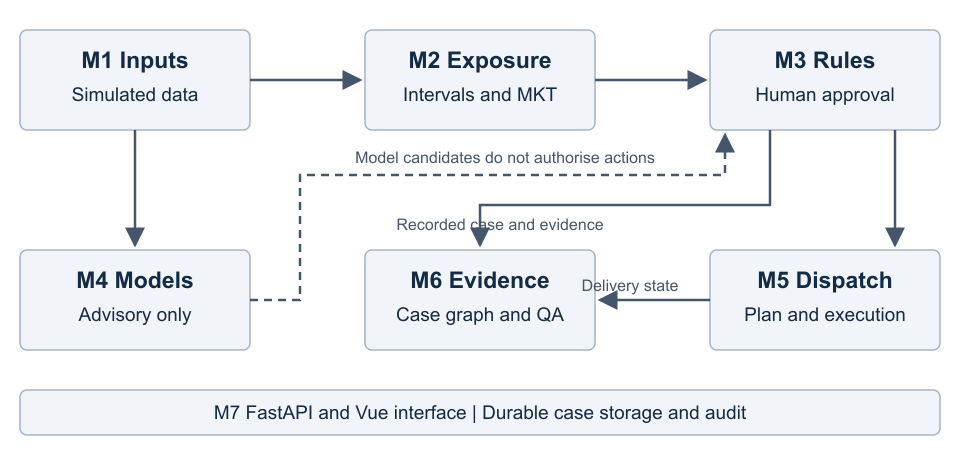

# PharmaColdOps Project Report

## Executive summary

PharmaColdOps is an explainable decision-support prototype for pharmaceutical cold-chain temperature excursions. We connect simulated temperature observations, rule-based disposition recommendations, human review, replacement delivery planning, and case-specific evidence queries in one runnable system. The prototype covers the IRS technique groups of decision automation, knowledge discovery and data mining, resource optimisation, and cognitive systems.

The principal result is an implemented, auditable workflow rather than a validated medicine-quality predictor. M3 agreed with historical adjudicated labels in 54 of 57 synthetic scenarios, but missed all three historical quarantine cases. The shipment-risk experiment achieved five-fold PR-AUC 0.7087 and F1 0.6635; monthly candidate-cause classification remained weak. A subsequent event-level simulation study improved held-out macro-F1, while retaining substantial multi-fault and extreme-condition failures. Static routing experiments produced complete feasible solutions in 49 comparisons. Independent M6 evaluation remains incomplete: reviewer A supplied both annotation files, while reviewer B's files and any necessary adjudication have not been collected. We report that gap explicitly.

Operational orders and event observations are simulated. Engineering temperature limits are not manufacturer stability limits, model candidates cannot authorise disposition, and human review governs the effective result used by downstream delivery. The deployment is a local demonstration with persistent storage and recovery checks, not a public or clinically validated service.

## 1 Business problem and intended value

An excursion creates two connected work requirements. Quality staff must reconstruct the exposure and justify a disposition, while dispatchers must maintain supply if replacement is required. A temperature alert alone does not connect those records. Our project investigates whether explicit rule paths, stable case identifiers and delivery constraints can make this process easier to inspect and demonstrate.

The intended users are quality reviewers, dispatchers, warehouse managers and auditors. The prototype lets them inspect the original observations, distinguish an automatic recommendation from a human decision, compare logistics alternatives and retrieve the evidence associated with the recorded case. Expected benefits include reduced duplicate data entry and clearer handover. We did not conduct an operational controlled trial or measure realised cost savings, medicine wastage reduction or staff productivity.

Commercial monitoring and quality platforms already provide shipment visibility and may support stability-profile workflows. We therefore do not claim that competitors merely raise alarms or that this project invents automated disposition. The differentiating educational contribution is an inspectable integration of rules, ML experiments, constrained routing and graph evidence. The market discussion in the submitted proposal is contextual research, not a current vendor benchmark [1].

## 2 Domain foundations and method selection

WHO TRS 961 Annex 9, EU GDP, ICH guidance and public SOP references provide principles for storage, transport, investigation and stability evidence. We distinguish those principles from our numerical engineering assumptions. A citation to ICH or WHO does not validate a configured excursion duration or mean kinetic temperature ceiling for a specific product [2].

We use deterministic priority rules where an operator must inspect the decision path. The rule engine has release, retest and scrap outputs under its current policy; quarantine remains a historical evaluation label and an available human outcome. Reshipment is a separate logistics action, not a fifth mutually exclusive disposition. Boundary, missing-evidence and low-temperature cases can require human review without rewriting the automatic snapshot [3].

For routing, Solomon VRPTW instances provide standard capacity and time-window problems. Greedy construction supplies an interpretable baseline; OR-Tools RoutingModel with Guided Local Search supplies time-bounded search; a genetic algorithm provides an additional experimental comparison. This is Routing Solver, not CP-SAT, and time-limited results do not prove optimality [6].

For tabular ML, logistic regression and histogram gradient boosting provide reproducible baselines. Offline SHAP and calibration experiments examine behaviour without treating associations as causes. For question answering, fixed intent routing and template Cypher queries allow explicit evidence and failure states. M6 is not an LLM or unrestricted semantic question-answering service [4, 7].

## 3 System architecture



The seven modules share case, order and product identifiers while preserving different responsibilities.

| Module | Implemented responsibility | Principal output |
|---|---|---|
| M1 | Dataset validation and reproducible simulated business inputs | Validated features and seeded order batches |
| M2 | Explicit temperature intervals, hot/cold windows and duration-weighted MKT | Exposure summary with coverage and source observations |
| M3 | Priority rules, evidence mappings and review requirements | Original recommendation and rule path |
| M4 | Risk and candidate-cause experiments and advisory inference | Versioned scores and candidate snapshots |
| M5 | Constrained delivery planning and execution | Plans, operation state and explicit infeasibility reasons |
| M6 | Neo4j case chains and structured evidence queries | Case-specific answers and provenance |
| M7 | FastAPI, Vue, SQLite persistence and Docker integration | Bilingual online interface and offline rule sandbox |

The main path is observation to assessment, registration, human review when required, replacement demand, route selection, execution and case closure. The advisory model path does not override M3. An accepted human outcome is stored separately and becomes the effective disposition for subsequent workflow checks. Historical rule and model snapshots remain unchanged [3, 8].

The API commits registration and its graph-outbox entry in one SQLite transaction. A background worker leases pending entries, retries failures and replays complete case chains idempotently into Neo4j. An outbox entry marked synced is not treated as proof that every graph relationship still exists: the audit endpoint can compare actual graph coverage to authoritative case records [8].

The Vue client supports same-origin API mode and an explicit offline rule sandbox. Offline mode does not register cases, write the graph or execute deliveries. The map displays cached road geometry and simulated progress rather than GPS or live traffic. The current operational deployment uses one API worker and loopback binding; distributed logistics transactions and authenticated multi-user operation are outside the demonstrated architecture [9].

## 4 Implementation and workflow

### 4.1 Temperature assessment and human review

M2 consumes explicit simulated temperature intervals and records known coverage. It calculates duration-weighted MKT, contiguous excursion windows and the selected event range. Missing intervals are not replaced with fabricated readings. A wholly unassessed sequence does not acquire an invented scalar temperature or MKT. The API recalculates derived values rather than trusting a mismatching client summary [10].

M3 records product, stage, packaging, exposure, rule number, reason and mapped evidence. Registration is durable and idempotent by draft identity. A boundary result can be registered for review without being treated as final approval. Pending review blocks linked downstream actions; an explicit human decision records reviewer identity, reason and time. Version checks reject stale mutations, and executed outcomes cannot be retroactively changed [3].

Case audit export provides printable HTML and a full JSON snapshot. It includes original assessment, human review history, recorded model identity, associated delivery state and actual graph coverage. It does not recompute an old case with a newer model. A content hash detects a changed snapshot but is not a cryptographic signature or compliance certificate [11].

### 4.2 Delivery planning and execution

The order generator records effective configuration, date, seed and source hashes. Operators can demonstrate routine demand, tight delivery windows, multiple sources or temperature zones, and insufficient resources. Real hospital orders, exact cargo quantities and warehouse stock balances are not required for this teaching scenario [12].

Independent urgent orders use the same operation and candidate constraints as ordinary replacement demand. Plan previews do not reserve a vehicle; adoption is an explicit action with version and retry protection. Execution uses a simulated clock. The final allowed parking facilities are a user-selected subset of five warehouses; hospitals cannot be day-end terminals. Parking must complete before a new day inherits vehicle positions [12].

Delay inspection identifies late remaining work and can preview reordering under the same constraints. Mechanical failures freeze the affected vehicle and retain failed original orders while separately tracking feasible replacement work. The demonstration does not invent vehicle-to-vehicle transfer, towing or repair capability. PDPTW in-transit rescue is explicitly unsupported rather than silently approximated [13].

### 4.3 Advisory models and graph queries

Risk and monthly candidate-cause models require explicit input contexts and save their first assessment with model identity. The independent event-v2 interface uses 111 allowed observation-derived features and a trusted read-only model bundle. Candidates and abstentions both require review; automatic actions remain disabled. Invalid or unavailable bundles produce an explicit unavailable state rather than a substituted model [5].

M6 supports disposition reasons, audit chains, product requirements, cause context and disposition statistics. Missing cases, insufficient evidence and graph unavailability are distinct states. The frontend's keyword router may fall back to a conceptual FAQ, which is not counted as a successful live graph query merely because it displays an answer [7].

## 5 Data and evaluation design

There is no public dataset in this project with independently validated medicine release, quarantine, retest and scrap decisions. We therefore evaluate each component against an appropriate and explicitly limited reference. The M3 scenario bank contains 57 synthetic scenarios with historical human adjudication. ML sources and licences are documented separately; the shipment-risk dataset is suspected synthetic and the monthly cause dataset is explicitly simulated [2, 4].

The risk task uses 8,000 shipment rows, including 1,574 failures, with 13 summary features. The cause task filters 16,192 excursion-month rows into ten candidate-cause classes with 15 features. The latter has 447 provided facility-ID groups and 48 months, but these are not verified real institutions or event timestamps [4].

The formal ML protocol separates fitting, calibration, selection and final outer testing. Risk uses five stratified outer folds because its source lacks timestamps. Cause experiments include random, provided-facility-ID and month-forward folds, with full and context-only feature sets. Preprocessing and weighting use the fitting partition; test data do not choose thresholds. These are separate tasks from event-v2 simulation and must not share an accuracy headline [4].

Event-v2 has 10,200 simulated events and 9,597 families across training, validation and five held-out roles. Models and screening policy were frozen before final test generation. Asset, family and excitation controls reduce shortcut leakage, but all cohorts still come from the same uncalibrated simulator. They do not establish external physical or clinical validity [5].

## 6 Experimental results

### 6.1 Rule engine

M3 agreed with 54 of 57 historical labels, or 94.7368%. Macro-F1 was 0.717437. Engine-to-gold Cohen's kappa was 0.909667; historical annotator-to-annotator kappa was 0.6434. These are different statistics. All three quarantine-labelled cases were missed because the current frozen engine policy has no automatic quarantine output. We retain those cases and the four-class denominator [3].

| Historical class | Support | Recall | F1 |
|---|---:|---:|---:|
| release | 13 | 1.0000 | 0.9286 |
| retest | 8 | 1.0000 | 0.9412 |
| quarantine | 3 | 0.0000 | 0.0000 |
| scrap | 33 | 1.0000 | 1.0000 |

The three discrepancies are S034, S035 and S052. They represent a difference between the written policy and historical adjudication, not proof that either side is clinically correct. Human review protects the operational workflow but does not improve this frozen automatic-engine score [3].

### 6.2 Shipment risk and monthly candidate causes

| Risk metric | Five-fold result |
|---|---:|
| F1 at selection-chosen thresholds | 0.6635 +/- 0.0179 |
| ROC-AUC | 0.9045 +/- 0.0092 |
| PR-AUC | 0.7087 +/- 0.0296 |
| Brier score before and after calibration | 0.1091 to 0.0933 |

For full15 monthly cause classification, macro-F1 was 0.1322 under random folds, 0.1308 under provided-ID folds and 0.1259 under month-forward testing. Corresponding Top-1 results were 0.1713, 0.1500 and 0.1497. Calibration improved probability losses but did not change class rankings. Weak extra feature signal, contextual shortcuts and insufficient event-level information motivated the separate learnability audit and simulator work [4].

Offline Kernel SHAP was matched to the relevant model identities and checked for additive reconstruction within its numerical tolerance. Online reference-feature replacement remains a sensitivity display and is not relabelled as SHAP. Neither method proves the cause of an individual event [4].

### 6.3 Event-level temporal study

| Held-out role | Selected temporal v2 macro-F1 | Frozen earlier event model macro-F1 | Supported candidate coverage |
|---|---:|---:|---:|
| nominal new assets | 0.7668 | 0.6125 | 17.33% |
| other new assets | 0.7619 | 0.6111 | 20.67% |
| unseen excitation | 0.7228 | 0.5880 | 13.83% |
| covered stress | 0.7528 | 0.5126 | 2.50% |
| more extreme stress | 0.6505 | 0.5068 | 0% |

Among supported candidates, complete-set precision was 96/104, 116/124 and 75/83 in the first three roles. Covered stress had only 15 supported events; 15/15 does not establish a population guarantee. Extreme stress supported none, so precision is unavailable rather than 100%. All 3,000 test events still required human review [5].

Raw normal-event false alarms remained 47.73-90.80%. Extreme multi-fault complete-set accuracy fell from 11.96% to 8.70% despite improved recall. Thermal-buffer F1 remained approximately 0.079-0.260. Observationally identical door/staff and power/fuel mechanism combinations show why tuning alone cannot resolve every cause label. The system must expose ambiguity and request additional evidence [5].

### 6.4 Static routing

The formal comparison has 49 solver runs across six Solomon instances and one Singapore instance. All runs served every target without recorded hard violations. On Singapore, greedy used three vehicles and 165.26 km; OR-Tools used three and 137.85 km. This is a 16.59% distance reduction for that frozen static instance, not an operational savings estimate [6].

OR-Tools matched the published two-decimal reference distances on C101 and C201. R101 and R201 had same-fleet distance gaps of approximately 0.1656% and 0.1753%. RC101 used 16 vehicles against the reference 14, so its shorter distance cannot be described as beating that reference. GA did not outperform OR-Tools in this experiment. Each configuration had one run; no multi-seed significance claim is made [6].

These are static single-origin algorithm comparisons. Urgent insertion, grouped operations, delay recovery, failure handling and overnight parking are implemented workflow features verified separately, not additional measured rows in that benchmark [6, 13].

### 6.5 Knowledge graph and independent human evaluation

The frozen M6 preparation performed 12 actual service queries and 41 client conceptual fallbacks on 53 questions. The same 57 case scenarios passed 466 derived contract checks for record agreement, mapped references, thresholds, states and case isolation. Derived checks do not establish independent answer correctness or citation relevance [7].

Reviewer A has supplied 53 intent labels and 53 answer/evidence ratings in separate completed files. The project owner confirmed human authorship on 2026-10-17. Structural checks verify IDs, allowed values and frozen hashes. Reviewer A assigned correctness 2 to 28 answers, 1 to 21 and 0 to four; evidence relevance was 0 for 41, 2 for eight and not applicable for four. Unsupported claims were flagged in ten answers. These are one reviewer's observations, not dual-rater adequacy or independent system accuracy.

Reviewer B's two files are unavailable in the repository. Human-human kappa, adjudicated intent accuracy and the proportion rated adequate by both reviewers are therefore unavailable. The A-rating upload also records corrections to reviewer ID and source URLs; actual consultation of replacement sources must be documented by the reviewer. Source strings and valid hashes cannot establish provenance, independence or professional competence [7].

## 7 Reliability and reproduction

The 2026-10-17 isolated regression passed 909 tests with zero skips and six existing warnings; a separate API walkthrough passed 36 checks against its own test graph. Frontend production build and eight frontend check scripts passed. Twenty live advisory sample replays and two browser preview branches preserved the original case records. These are software checks, not new model-accuracy observations [9].

An initial run passed 892 tests and failed one because the temporary QA fixture had not loaded road relationships. We preserved that result, loaded the complete standard static seed in a new test graph and reran successfully. The historical 2026-10-04 baseline of 888 tests remains a separate record. Local map-tile and no-active-operation 404 responses, plus a large-JavaScript-chunk warning, remain disclosed presentation limitations [9].

The deployment pins Python, frontend and Docker dependencies, runs the API as a non-root user with read-only root filesystem, and persists authoritative case data independently of Neo4j. Previous acceptance exercised actual API restart, graph outage, outbox recovery and backup restoration into new volumes. These checks demonstrate recovery for the tested configuration, not high availability or a production service-level agreement [8, 9].

For reproduction, clone the repository, create the documented Python 3.12 environment, install the evaluation lock, and use the Linux-container Docker path. Native Windows workflow mutations are unsupported because their file guard requires Unix fcntl; the standalone M6 format checker is portable. Native Linux amd64 and arbitrary offline builds have not been established by the historical arm64 checks [9].

## 8 Findings and remaining work

The implemented rule, review, logistics and graph boundaries make failures inspectable. In particular, a reviewer can trace original evidence without conflating it with a later human outcome, and a failed graph write does not silently erase the authoritative case. The experimental results also limit the product claim: historical policy disagreement, weak monthly causes, multi-fault omissions and incomplete M6 human evidence prevent a claim of autonomous pharmaceutical judgement.

Before submission, the team must complete or explicitly disclose the missing M6 independent review, document source verification and seal times, record two five-minute videos with human speech, and submit individual reflections and peer evaluation privately. A frozen source package and a report are not evidence that these human deliverables exist. The [delivery checklist](最终交付与验收.md) records the remaining inputs.

## References and project evidence

1. Submitted proposal, PharmaColdOps-Proposal-Group 41.pdf, 2026-09-13. Reproduced as Appendix C in the PDF report.
2. [Threshold evidence audit](阈值证据表_v1.md) and [data dictionary](../data/ml/DATA_DICTIONARY.md). Public anchors: [WHO TRS 961 Annex 9](https://www.who.int/publications/m/item/trs961-annex9-modelguidanceforstoragetransport) and [EU GDP](https://eur-lex.europa.eu/legal-content/EN/TXT/?uri=CELEX:52013XC1123%2801%29). The project audit records applicability and assumptions.
3. [M3 formal evaluation](M3正式评估.md) and [human effective dispositions](人工审核与有效处置.md). Frozen formal evaluation, 2026-10-03.
4. [M4 formal experiments](M4正式实验.md) and [cause-data learnability audit](原因数据可学性审计.md). Formal folds, calibration, ablations and model-matched explanations.
5. [Temporal event-v2 evaluation](事件时序模型v2评估.md) and [shadow API and UI](v2只读shadow接口与演示入口.md). Independent event study and advisory contract.
6. [M5 formal evaluation](M5正式评估.md). Solomon, M. M. (1987), Algorithms for the Vehicle Routing and Scheduling Problems with Time Window Constraints, [original paper](https://doi.org/10.1287/opre.35.2.254); frozen comparison documented against [SINTEF reference results](https://www.sintef.no/projectweb/top/vrptw/100-customers/).
7. [M6 independent evaluation](M6独立评估.md), [reviewer A intent labels](../data/qa/m6-completed-20261016-intent-A.csv) and [reviewer A answer ratings](../data/qa/m6-completed-20261016-ratings-A.csv). Individual review inputs, not a complete two-rater report.
8. [Graph reliability and recovery](知识图谱可靠性与恢复.md) and [case audit export](案例审计报告导出.md). Authoritative storage, graph coverage and recovery scope.
9. [Reproduction and deployment](复现与本机部署.md), [controlled v2 deployment](v2演示受控更新.md) and [progress log](../PROGRESS.md). Versioned deployment and historical verification records.
10. [M2 temperature and MKT](M2温度序列与MKT.md). Interval semantics, MKT and missingness contracts.
11. [Case audit export](案例审计报告导出.md). Snapshot and hash scope.
12. [Simulated order generator](模拟订单生成器.md) and [urgent orders and parking](独立加急与仓库停车规则.md). Simulated business-input and parking constraints.
13. [End-to-end acceptance](完整演示与端到端验收.md) and [routing design](路径规划总逻辑方案.md). Dynamic workflow scope and acceptance protocol.

## Appendix A Mapping to modular course techniques

| Course area | Applied knowledge and implemented functionality | Evaluation evidence |
|---|---|---|
| MR Machine Reasoning | Knowledge/model representation, reasoning as search and inductive learning: explicit rule paths, constrained route construction and tabular risk/cause models | 57 rule scenarios; search baselines; five-fold ML and held-out simulations |
| RS Reasoning Systems | Optimisation and evolutionary computation: VRPTW formulation, RoutingModel GLS and permutation-based GA; graph-based system integration | Static 49-run routing comparison and separate dynamic execution acceptance |
| CGS Cognitive Systems | Knowledge representation and reasoning with a case/rule/evidence graph and structured user questions; five template queries with explicit failure states | Derived contract checks; independent M6 review still pending; no audio or vision claim |

This mapping follows the course agendas in the IRS practice-module briefing, page 3. The separate four technique groups are decision automation (M3), business resource optimisation (M5), knowledge discovery/data mining (M2/M4), and cognitive systems (M6). It does not assert that every optional feature or course topic, such as audio/vision cognition, was implemented.

## Appendix B Installation and user guide

### B1 Fresh demonstration deployment

Requirements are Docker Desktop in Linux-container mode, a free loopback port 8080 and Python 3.12. Create an environment with python3.12 -m venv .venv, then install requirements-eval.lock.txt. On Windows use .venv/Scripts/python.exe in place of .venv/bin/python. First builds require registry, PyPI and npm access.

```text
.venv/bin/python scripts/configure_demo.py
docker compose --env-file deploy/demo.env -f deploy/compose.demo.yml config --quiet
docker compose --env-file deploy/demo.env -f deploy/compose.demo.yml up -d --build --wait --wait-timeout 180
```

Open http://127.0.0.1:8080/?lang=en and check /api/ready. This base deployment defaults to event-v2 disabled. For the existing v2 demonstration use both env files and both compose files from the [controlled deployment guide](v2演示受控更新.md); do not recreate that deployment using only the base configuration. Never add -v when stopping the application's persistent volumes.

### B2 Operator walkthrough

Generate a seeded daily batch and inspect the date, time windows, fleet and allowed final warehouses. Preview the plan and confirm departure. Pause simulated progress while demonstrating an urgent order or registering an excursion linked to the correct original order and occurrence facility. Examine the original rule recommendation and its evidence. Complete human review if required, compare feasible replacement candidates, then adopt one explicitly.

Resume simulated progress and inspect actual recorded delivery status. Complete case notes only after required delivery conditions are met. Ask for the selected case's disposition reason or audit chain; distinguish a conceptual FAQ from graph evidence. Export its HTML/JSON audit. At day end, complete legal warehouse parking before starting the next day. Hospitals are not final parking sites.

### B3 Failure handling and offline mode

Readiness failure can indicate unavailable storage, models or graph dependencies. Use the documented compose ps/logs commands for the actual selected deployment. A map without online tiles can still display the route geometry. Offline rule mode remains available for presentation, but must be disclosed as offline and cannot execute deliveries. Do not run a graph loader against a populated deployment to fix a missing relationship; use the audit and non-conflicting repair procedure.

The full [English manual](user-manual-EN.md) and [Chinese manual](用户手册.md) provide panel-level instructions, troubleshooting and the separate M6 review process. This appendix summarises installation and operation.

## Appendix C Submitted project proposal

The PDF report appends the unchanged 2026-09-13 submitted proposal. It is a historical planning document; current implementation, experiment results and outstanding work are described in this report. The editable DOCX contains this appendix introduction and identifies the original PDF as a companion source.

The historical proposal cover still says Project Group 52. The revised proposal source and current presentation identify the team as Project Group 41, which is used on this report and member-github.txt. The four member identities are unchanged. We retain the submitted appendix as a historical record rather than silently alter its cover.
